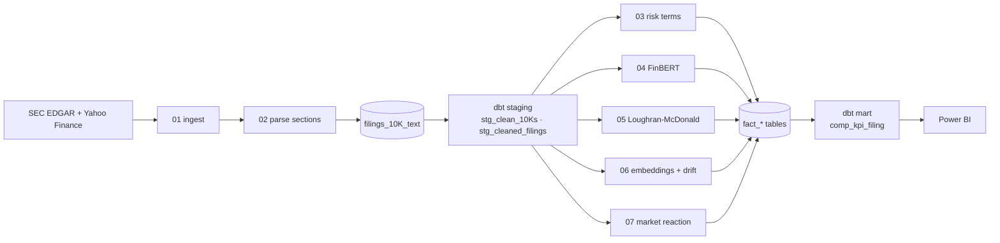

# Trading Sentiment Platform

**NLP on SEC 10-K filings: managerial tone, risk language and year-over-year narrative change for the largest US companies.**
Databricks (PySpark, Delta) · dbt · FinBERT · Loughran-McDonald · OpenAI embeddings · Power BI

[](../../actions/workflows/ci.yml)

Filings are downloaded from SEC EDGAR, split into **Business**, **Risk Factors** and **MD&A**, scored with several
complementary text signals, and modelled with dbt into one KPI table that feeds a Power BI dashboard
(`powerbi/`, exported PDF included).

## Pipeline



Run order: `01 → 02 → dbt build --select staging → 03 … 07 (any order) → dbt build --select marts`.

## Signals

| Signal | Notebook | What it measures |
|---|---|---|
| Loughran-McDonald buckets | 05 | Optimism (positive) / Caution (uncertainty + constraining) / Concern (negative + litigious), per 1,000 tokens and as shares, per section |
| FinBERT probabilities | 04 | P(positive), P(negative), P(neutral) per section, averaged over up to 32 chunks of 510 tokens. Used as a *signal*, not a label: regulatory text is cautious by design |
| Risk terms and density | 03 | Lemma-matched keyword hits in Risk Factors (43 terms incl. phrases such as *supply chain*), per 1,000 words, and change vs the previous filing |
| Narrative drift | 06 | Cosine distance between a section's `text-embedding-3-large` vector and the company's previous filing |
| Market reaction | 07 | 1/5/20-trading-day return and 20-day annualised volatility after the filing date |

## Repository layout

```text
.
├── databricks_notebooks/     01 … 07, numbered in run order (thin: they call the package)
├── trading_sentiment/        tested Python: EDGAR parsing, section extraction, chunking, label mapping, ...
├── dbt_models/               staging views, KPI mart, tests; ci/ profile runs the models on DuckDB
├── tests/                    pytest: package logic + `dbt build` on fixture data
├── powerbi/                  dashboard (.pbix) and PDF export
└── .github/workflows/ci.yml  ruff + pytest
```

## Setup (Databricks)

1. Add this repo as a **Git folder**; the notebooks put the repo root on `sys.path` themselves.
2. Create the catalog/schema `workspace.sec_filings` (change `trading_sentiment/__init__.py` for another one).
3. Secrets: scope `openai`, key `openai-api-key` (notebook 06).
4. Download the [Loughran-McDonald master dictionary](https://sraf.nd.edu/loughranmcdonald-master-dictionary/) (not
   redistributed here) into a volume and set the `lm_csv_path` widget of notebook 05.
5. Notebooks 01 and 02 ask for a **SEC User-Agent** widget (`Your Name you@example.com`); the SEC blocks anonymous clients.
6. dbt: `pip install dbt-databricks`, copy `dbt_models/profiles.example.yml` to `~/.dbt/profiles.yml`, see
   [`dbt_models/README.md`](dbt_models/README.md).

## Data quality

- dbt tests: not-null keys, unique `(cik, filing_date)`, 5,000-character minimum for every section in `stg_clean_10Ks`,
  bounded shares/scores, `risk_cosine_distance` in `[0, 2]`.
- `comp_kpi_filing` keeps a filing only if it has a previous filing to compare with and its company has at least two
  such filings (trend charts need a series). The `valid_filing_count` column exposes this.
- `pytest` builds the models on DuckDB with fixtures and checks the mart (row selection, dominant narrative,
  risk-density change, FinBERT split). The notebooks themselves need Databricks, Yahoo Finance, the SEC and OpenAI;
  they were smoke-tested on local Spark with stub data.

## Known limitations

- **Survivorship bias:** the "top 100" is ranked by *today's* market cap (Yahoo Finance), not the cap at filing time.
- **Section parser:** first-heading regex heuristics on cleaned HTML; filings with unusual headings produce empty
  sections and are dropped by dbt (Costco is excluded explicitly). Only the SEC `recent` submissions block is read.
- **FinBERT** samples at most 32 chunks (about 16k tokens) per section; very long sections are covered evenly, not fully.
- **Embeddings** use the first 20,000 characters of a section; drift is computed against the previous filing only.
- **Yahoo Finance** is an unofficial API: throttled and occasionally changes shape; market metrics are descriptive, not a trading signal.
- Batch pipeline; no incremental filing ingestion yet.

## Ideas

Earnings-call transcripts, vector search over sections, peer-relative scores in the mart, XBRL financial data instead of scraped text.
